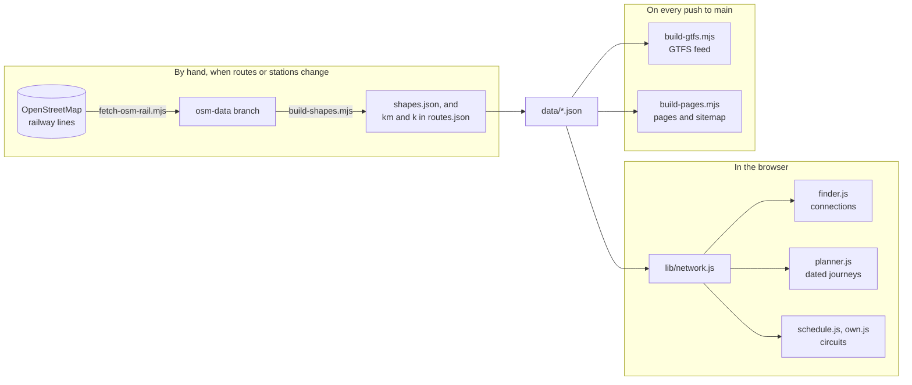

# How IVB works

Design notes for the parts of IVB that do more than they appear to: the two journey searches, the circuit scheduler and the track tracer. [DATA.md](../DATA.md) describes the data files, and the [README](../README.md) how to run, check and publish the site.

## The shape of it

IVB has no server. The searches run in the visitor's browser on the JSON files in `data/`; the GTFS feed and the plain pages are built from the same files on every push, and the track lines by hand when routes or stations change:

The code in `lib/` is plain functions with no access to the page, so the website, the page builder and the tests all use the same code. `lib/network.js` turns the data into the network the searches work on: stations with the routes that call at them, routes with their stops in order, and trains with a direction and a time at each halt.

## Days and times

India keeps one time zone, India Standard Time, with no daylight saving, so IVB never converts between time zones.

- **A date** is a whole number of days since 1 January 1970 (UTC). Its weekday is `(day + 4) % 7`, because 1 January 1970 was a Thursday. Working in whole days means a date never shifts with the time zone of the browser that shows it.
- **A time in a timetable** is minutes after midnight plus the number of days since the train left its first station: `"00:40+1"` is `{ min: 40, day: 1 }`.
- **A train's days** are the days it leaves its first station. `runsOn()` shifts them by the day offset at a later station, so a train that leaves Delhi on a Monday evening is at a station on its way on Tuesday.

## Connections: whatever the day

`findJourneys()` in `lib/finder.js` answers the Connections tab: every sensible way between two places on Vande Bharats alone, on any day, fewest trains first. It works on routes, not on dated trains, because the question has no date.

1. **How deep to look.** `fewestTrains()` finds the fewest trains the journey can take, ignoring times. It is a breadth-first search in which riding a train costs 1 and a change of station by road costs 0 (a "0-1 BFS", which keeps a double-ended queue). Its states remember whether the last move was by road, so two road changes never follow each other, and a journey never starts with one. The main search then goes as deep as the visitor asked, or, for "any number of changes", to one train more than the fewest (and at least seven trains).
2. **Round by round.** Round *k* extends each partial journey by one more train: from where it is, along each route that calls there, in both directions, to every later stop. A partial journey never uses the same route twice or passes a station it has already passed. After a train it may change station by road within a city: stations up to 15 km apart count as one city, and the road distance is the straight distance plus 30%.
3. **A beam, with a safety net.** After each round only the five shortest partial journeys at each station go on. That keeps the search fast, but it could lose the journey with the fewest trains, so that journey (from step 1) is added back if it went missing.
4. **Weeding.** A train that runs straight through makes any change onto it or off it pointless, so when there is a direct train, journeys that use part of its route are dropped. A journey longer than 1.8 times the shortest plus 150 km is dropped too, unless it is the shortest with its number of trains.
5. **Order.** Fewest trains first, then fewest nights on the way, then shortest. Each ride is matched to a train in its direction and given its times, and each change is marked as same day (at least 20 minutes between trains, plus the road time) or overnight.

The first station of a city matters: a journey from Mumbai should board at Mumbai Central, not at Borivali half an hour later on the same train. Both searches (this one and the dated one below) let a journey board only at the first station in the city that the train calls at.

## Dated journeys: RAPTOR

`planJourneys()` in `lib/planner.js` answers "I leave on this day: which trains, and when do I arrive?" It uses RAPTOR (Delling, Pajor and Werneck, *Round-Based Public Transit Routing*, 2012), the method many journey planners use, in its range form.

**The trips.** Each run of each train is a trip: the train's halts in order, with times in minutes after midnight on the day the visitor leaves. For a departure day *D* the planner takes every run that leaves its first station between *D* − 2 (a train two days into its run can still be passing) and *D* + 14 (a journey may leave up to six days late, when nothing leaves on *D*, and take up to eight days). With 971 runs a week that is about 2,350 trips, few enough to scan them all, so the planner skips RAPTOR's usual lookup of the earliest trip on each route.

**One run of RAPTOR** starts from the origin's stations at a time *t₀* and goes in rounds. Round *k* finds the earliest arrival at every station using at most *k* trains:

- A trip can be boarded at a station whose arrival improved in the last round, if the train leaves there at least 20 minutes after the arrival (or, for the first train, at or after the start time).
- Riding the trip on improves the arrival at every later halt it reaches sooner than before.
- After a train, a road change to a station in the same city takes 4 minutes per km. It counts for the next round, like any other improvement.
- An arrival later than the best arrival at the destination so far is ignored (target pruning), and so is one more than eight days after the start of the day the journey leaves.

When a round improves the destination, the journey is traced back through the rounds: one journey for each number of trains, each arriving sooner than the one with fewer trains.

**The range form.** A journey that waits two hours for a train arrives no sooner than one that simply leaves on that train, so one run from midnight would hide the better journey. The planner runs RAPTOR once from each time a train leaves the origin that day, latest first. Delhi, the busiest place, has about 15 departures a day, so this means about 15 runs. Each run starts afresh rather than reusing the labels of a later run as rRAPTOR does: simpler, and fast enough. A search takes from about 15 to 100 ms in Node, longest for journeys across the country with five or six trains.

**Keeping the best.** The journeys from all the runs are pooled, and a journey is kept only if no other leaves as late or later, arrives as soon or sooner, and takes no more trains. The rest are sorted soonest arrival first and the first six shown. If no journey leaves on the day asked (no train that day, say), the planner tries the next day, and so on for up to a week.

**Booking.** Indian Railways opens bookings 60 days before a train leaves its first station, at 8 am India time. `lib/booking.js` works out the day for each ride: a ride boarded just after midnight on a train that left the evening before opens a day earlier than the date on the ticket suggests.

## Circuits

A circuit is a loop of stops. Each stop names a place, its station, the nights there and a *move*: the rides, and any road change, to the next stop. The ready-made circuits are in `data/circuits.json`; your own are made from the places you pick (below). `schedule()` in `lib/schedule.js` lays either out on the calendar from a start date:

- The planned day to leave a stop is the day you arrived plus its nights. If the move cannot be made that day, because a train has its weekly day off, the scheduler tries each following day, up to a week, and adds the extra nights to the stop. The plan reports these waits.
- On a day stop (no night), the onward train must leave at least 30 minutes after you arrive; between two trains in one move the margin is 20 minutes, plus 4 minutes per km of any road change.
- A ride lists the trains that can make it, and the first that runs on the day and leaves late enough is chosen. If none runs within a week the plan still shows the first option, with a warning, so it never comes out empty.

**When to go.** `seasonScore()` gives each stop a mark for the month in the middle of the stay (2 for a good month, 1 for a fair one and 0 for one to avoid, from `places.json`), weighted by the nights there, and reports the share of the best possible. `seasonScan()` lays the circuit out from the 1st and the 15th of each month for a year, which is what the chart under the circuit shows.

### Your own circuit

`lib/own.js` turns the places and nights you pick into stops with moves, in the same shape as `circuits.json`, so the same scheduler lays them out. The list travels in the link: `?loop=own&stops=delhi.2,agra.1,varanasi.2&date=2027-01-11#circuits` means two nights in Delhi, one in Agra, two in Varanasi and back to Delhi, leaving on 11 January. Nights run from 0 to 7, and a circuit needs at least two places.

For each hop, the last back to the first, `buildCircuit()` asks the connection finder for the journey with the fewest trains. It then lists, for each ride, every train of that route in that direction that calls at both stations, earliest first, so that the scheduler can pick whichever runs on the day. If you arrive at one of a city's stations and the next train leaves from another, it adds a road change between them.

A ready-made circuit is planned so that its changes work on the day. An own circuit cannot be, so every ride after the first in a hop is *flexible*: if no train for it runs that day, or none leaves late enough to catch, the scheduler waits at the change for the next one, a night or more, up to a week. That is what a traveller would do, and the plan shows the nights it adds.

## The track tracer

The map's lines, the distances by rail and the GTFS feed's shapes come from India's railway lines in OpenStreetMap. `tools/build-shapes.mjs` traces each two stops that follow each other on a route along the track. It runs by hand after routes or stations change ([DATA.md](../DATA.md#tracing-the-track) has the steps), and its output is committed, so building the site never depends on OpenStreetMap being reachable.

**The railway lines.** The **Fetch OpenStreetMap railway lines** workflow asks the public Overpass servers for every railway line in tiles of 3° by 3°, leaving out sidings, yards, spurs and industrial, military and heritage lines. A query clipped to India's outline would be neater, but it is too slow for the public servers. It keeps only the tags the tracer reads (gauge, usage, traffic mode and name), and saves the result, about 9 MB gzipped, on the `osm-data` branch, which holds only the latest copy, so the main branch stays small.

**The track graph.** Only broad gauge counts (1,600 to 1,700 mm, or no gauge given), since Vande Bharats run on nothing else: that leaves out about 11,000 of the 75,500 lines. Ways that share an OpenStreetMap node are joined there. Every stretch longer than 300 m gets extra points, so that a station can find a point of track close to it; the graph has about 840,000 points. A stretch costs its length, four times its length on a line marked for freight, and ten times on a line outside India. India's outline is held as a grid of 0.05° cells, about 5 km, filled from the outline and grown by one cell, so a line near the border is not mistaken for one abroad. These costs keep a route out of Bangladesh and off freight corridors when a passenger line will do.

**Breaks in the map.** OpenStreetMap's lines sometimes stop short of each other: two ways that should meet end a few metres apart, or a bridge or new alignment is missing. Every loose end of track is joined to the nearest track within 1.5 km that cannot be reached along the track within 5 km. A join of up to 50 m costs its length; a longer one costs three times its length plus 1 km, so a line takes it only across a real break. The report names each such break a line crosses. There are about 3,400 joins.

**The search.** For each pair of stops the tracer takes every point of track within 1.5 km of each station (4 km when `stations.json` marks either station's position as approximate), doubling the distance up to 12 km if it finds none. Every point near the first station is a starting point, costed at twice its distance from the station, and every point near the second is an end, costed the same way. A* then finds the cheapest way between them, with the straight distance to the second station as its estimate of the cost still to come. The estimate never exceeds the true cost, since every stretch costs at least its length, so the line found is the cheapest. A search gives up beyond three times the straight distance plus 30 km. The 470 pairs take under half a second; the whole run, with loading and building the graph, about two seconds.

**Checks on the result.** A line more than three times the straight distance is not used (mountain and city lines reach 2.6), and the pair is listed as `estimated`: the map draws it straight and counts its distance as the straight distance plus 20%. At present every pair is traced. The report also lists for checking by eye any line more than 1.45 times the straight distance, any station more than 600 m from the track it joined, which usually means its position needs fixing, and any line that crosses a break in the map.

**The output.** Each line runs from the station's own position, along the track, to the next station's, so a route's line passes exactly through its stops. It is simplified with the Douglas–Peucker method to within 40 m, which cuts about 245,000 points to 18,000, and stored in Google's encoded polyline format (precision 5) in `data/shapes.json`, about 63 KB gzipped. Each route in `routes.json` gets `k`, the distance by rail from its first stop to each stop, and `km`, its whole length; the finder and the planner work out each ride's distance from `k`.

**In the GTFS feed.** `tools/build-gtfs.mjs` joins the lines of each route into one shape for each direction. Since the line passes through every stop, the distance of each stop along it (`shape_dist_traveled`) is exact, and `tests/run.js` checks that each line starts and ends at its stations.

## How these are checked

`tests/run.js` checks the searches as well as the data. Among its checks:

- Known answers: Chennai to Mysuru on a Monday comes out as the 20607 first, and Mumbai to Srinagar boards at Mumbai Central.
- Every dated journey found between 280 pairs of places, each on a different weekday, uses each train on a day it runs, arrives after it leaves, and leaves enough time at every change.
- Both ready-made circuits, and three own circuits across the country, use only trains on days they run, and each own circuit visits every place it was given.

`tests/ui.mjs` then runs the site in Chromium: the searches through the page, the own circuit's link and calendar file, a phone-sized screen, accessibility checks with axe-core in light and dark, every address in the sitemap, and the GTFS feed. Each week it runs against the published site too.

## Limits

- **Changes.** Every station gets the same 20 minutes to change trains, and road changes assume city traffic at 4 minutes per km. A change at a big station, or across Delhi at rush hour, can take longer.
- **The timetable is the plan, not the day.** IVB does not know about delays, cancellations or seats. Vande Bharat timetables change every few weeks, which is why each train records when it was checked and against what.
- **Connections are a beam search.** The five shortest partial journeys at each station are usually enough, and the journey with the fewest trains is always kept, but an unusual journey can be missed.
- **The track is only as good as the map.** Where OpenStreetMap misses a link or tags a line wrongly, a line can take a detour or a wrong parallel track. The tracer's report is there to catch these, and the fix is to correct OpenStreetMap or the station's position, then trace again.
